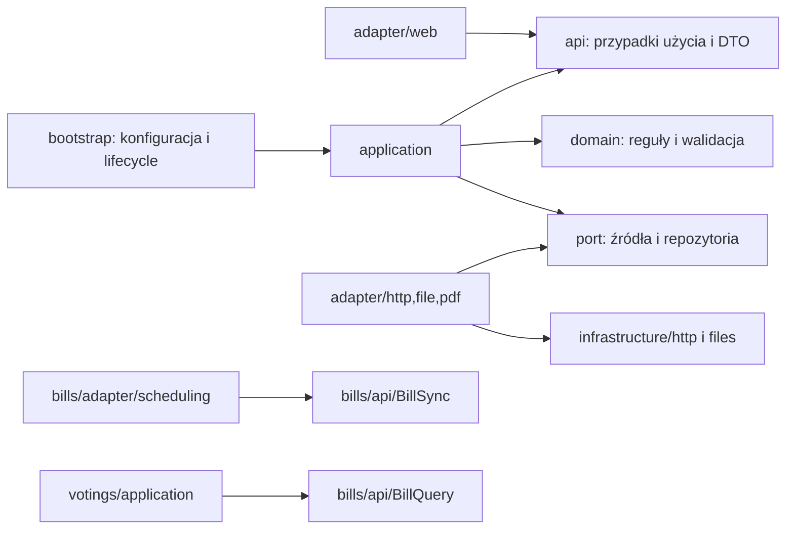

# Goniec z Wiejskiej — backend

Implementacja w Java 21, Spring Boot 3.5.16, Maven, Apache PDFBox 3.0.6. Wszystkie zmiany wykonane przez implementującego backend są w `backend/`. Seed jest zarządzany przez root: backend go tylko odczytuje, nie tworzy ani nie nadpisuje. Frontend i root README nie były modyfikowane. Bez commitów i bez dodatkowych agentów.

## Uruchomienie

W środowisku z Java 21 i Maven 3.9.x:

```sh
cd backend
./mvnw verify
./mvnw spring-boot:run
```

`mvnw` jest jawnym launcherem offline, a nie kompletnym oficjalnym Maven Wrapperem. Korzysta z `mvn` w PATH, `$MAVEN_HOME/bin/mvn` albo wcześniej rozpakowanego Maven 3.9.9 w `$MAVEN_USER_HOME/wrapper/dists/apache-maven-3.9.9/bin/mvn` (domyślnie pod `~/.m2`). Nie pobiera skryptów, JAR-ów ani dystrybucji. `.mvn/wrapper/maven-wrapper.properties` wskazuje dystrybucję referencyjną; JAR wrappera nie został pobrany. Sam build wymaga dostępnych zależności Maven lub sieci w środowisku docelowym.

```sh
docker build -t goniec-z-wiejskiej backend
docker run --rm -p 8080:8080 \
  -v sejm-cache:/app/data/cache \
  -v "$PWD/data/seed-bills.json:/app/data/seed-bills.json:ro" \
  goniec-z-wiejskiej
```

Obraz buduje i uruchamia testy w etapie Maven, następnie uruchamia JRE 21 z UID/GID 10001. Wolumen cache musi być zapisywalny dla tego użytkownika. Seed jest osobnym montowaniem read-only. Dockerfile nie dołącza seedu do obrazu.

## HTTP

Domyślny port: 8080. CORS dopuszcza `http://localhost:5173`, GET/POST/OPTIONS.

| Metoda i ścieżka | Zachowanie |
| --- | --- |
| `GET /api/bills` | `{ "bills": [Bill] }`, malejąco według daty doręczenia i liczbowego numeru |
| `GET /api/bills/{id}` | Bill, np. `10-3355`; 404 dla nieznanego ID |
| `GET /api/status` | `lastCheckedAt`, `lastSuccessAt`, `syncing`, `error`, `intervalMinutes`; nieustalone daty i brak błędu jako null |
| `POST /api/sync` | Asynchroniczne 202 z `{syncing:true,started:boolean}`; podczas istniejącej synchronizacji `started:false` |
| `GET /api/bills/{id}/pdf` | PDF z cache; 404, jeśli projekt lub pobrany PDF nie jest dostępny |

Błędy HTTP używają `application/problem+json` i pola `detail`. Bill ma pola zgodne z umową, datę ISO YYYY-MM-DD i status `analyzed` lub `pending`. `textPreview` może być pominięte. `sourceUrl` prowadzi do oficjalnej karty druku. Po pobraniu `pdfUrl` wskazuje `/api/bills/{id}/pdf`; przed pobraniem seed zachowuje swój oficjalny URL. GET PDF nie uruchamia pobierania ani synchronizacji.

## Konfiguracja

Ścieżki względne są liczone od katalogu roboczego procesu. Przy `cwd=backend/` wartości domyślne wskazują root `data/`.

| Zmienna środowiskowa | Domyślnie |
| --- | --- |
| `PORT` | `8080` |
| `DATA_DIR` | `../data/cache` |
| `SEED_PATH` | `../data/seed-bills.json` |
| `SYNC_INTERVAL_MINUTES` | `30` |
| `STARTUP_SYNC` | `true` |
| `CONNECT_TIMEOUT_SECONDS` | `10` |
| `REQUEST_TIMEOUT_SECONDS` | `60` |
| `MAX_PDF_BYTES` | `26214400` (25 MiB) |
| `MAX_JSON_BYTES` | `20971520` (20 MiB) |
| `MAX_PDF_PAGES` | `300` |
| `MAX_TEXT_CHARS` | `300000` |
| `CORS_ORIGIN` | `http://localhost:5173` |

Adres API: `https://api.sejm.gov.pl/sejm/term10/prints`, konfigurowalny przez Spring property `sejm.base-url` / `SEJM_BASE_URL`. Zakres backendu pozostaje ograniczony do kadencji 10. Dodatnie limity i interwały są walidowane przy uruchomieniu.

## Synchronizacja i trwałość

Po starcie aplikacja udostępnia cache lub seed, a synchronizacja startowa działa w tle. `@Scheduled` wyzwala kolejne próby co skonfigurowany interwał. Ręczny POST i scheduler współdzielą atomową blokadę: działa najwyżej jedna synchronizacja w procesie.

1. Pobierana jest lista druków. Wybierany jest projekt ustawy rozpoznany po początku tytułu i autorze (rządowy, poselski, senacki, obywatelski, prezydencki/przedstawiony przez Prezydenta, komisyjny). Uchwały, sprawozdania i dodatkowe druki o numerach innych niż cyfrowe są odrzucane.
2. Najnowszy oznacza maksimum `deliveryDate`, potem liczbowy numer druku. `changeDate` nie zmienia kolejności.
3. Backend pobiera szczegóły `/prints/{number}` i załącznik `/prints/{number}/{attachment}`. Preferuje `{number}.pdf`, inaczej pierwszą bezpieczną nazwę PDF w kolejności leksykograficznej.
4. Każda próba pobiera PDF ponownie, również gdy metadane się nie zmieniły, aby wykryć podmianę treści. SHA-256 deduplikuje pliki i decyduje o ponownej analizie. Rekordy są aktualizowane po ID, bez duplikatów.
5. Seed `{ "bills": [...] }` jest wczytywany tylko przy braku prawidłowego cache. Przykładowy root seed ma ID `10-3355`. Ręczne podsumowanie `analyzed` bez zapisanego hasha zostaje zachowane podczas pierwszego pobrania, a hash zostaje przypięty w cache. Taki sam hash zachowuje podsumowanie. Kolejna zmiana hasha uruchamia lokalną analizę. Rekordy `pending` są ponownie analizowane.
6. JSON `cache.json` przechowuje Bill, hash, ścieżkę PDF i status synchronizacji. PDF ma nazwę `pdf/{sha256}.pdf`. Najpierw zapisywany jest PDF, następnie JSON przez plik tymczasowy i atomowe przeniesienie, z fallbackiem na zwykłe replace, jeśli filesystem nie obsługuje ATOMIC_MOVE. Stary JSON nadal wskazuje na stary PDF w razie przerwania zapisu. Osierocone/stare PDF-y nie są automatycznie usuwane.

Awaria sieci nie usuwa dotychczasowych danych. `lastCheckedAt` oznacza początek próby, `lastSuccessAt` ostatnią poprawną synchronizację z analizą. Błąd ekstrakcji zapisuje dostępny PDF i rekord `pending`, ustawia `error` i nie przesuwa `lastSuccessAt`. Stan `syncing` jest tylko stanem bieżącego procesu. Status i błędy są zapisywane do cache; przy niedostępnym dysku błąd pozostaje w pamięci i logach.

Uszkodzony cache jest kopiowany do `cache-corrupt-*.json`, a aplikacja próbuje seedu. Brak obu plików daje pustą listę do czasu synchronizacji. Nieprawidłowy seed powoduje błąd uruchomienia z przyczyną w logach. Zmiana seedu przy istniejącym prawidłowym cache nie nadpisuje cache. Wdrożenie zakłada jedną instancję zapisującą dany katalog; blokada między procesami nie jest zaimplementowana.

## Analiza lokalna

Brak integracji z zewnętrznym API AI. Metoda `local-extractive-v1` deterministycznie wybiera cytaty z tekstu PDFBox: pierwszy dłuższy fragment jako lead, maksymalnie pięć fragmentów z frazami zmian przepisów i pierwszy fragment zawierający frazę wejścia w życie. Normalizuje białe znaki i podziały słów między wierszami. Fragmenty dłuższe niż 800 znaków mają jawne oznaczenie `[…]`.

Algorytm nie oblicza dat, nie identyfikuje samodzielnie grup objętych zmianą i nie dopisuje skutków. Brak rozpoznania daty daje komunikat „Nie ustalono”, a `affectedGroups` pustą listę z wyjaśnieniem w caveats. Pusta lista nie stanowi twierdzenia o braku skutków. PDF może zawierać pismo przewodnie, uzasadnienie i załączniki; dobór cytatów nie zastępuje ręcznej analizy. Dokumenty obrazowe bez warstwy tekstowej pozostają `pending`; OCR nie ma.

Limity stron i znaków skracają analizę, nie odrzucają PDF. Skrócenie jest oznaczane w caveats. Przekazany przez root najnowszy druk 3355 ma 159 stron, zatem domyślny limit 300 stron go nie blokuje; limit znaków może nadal skrócić zakres ekstrakcji. Pobieranie PDF/JSON ma limit bajtów oraz timeout całej odpowiedzi, również jej body. Przekierowania HTTP są wyłączone, nazwy załączników sprawdzane, sygnatura `%PDF-` weryfikowana. Timeout dotyczy sieci; ekstrakcja PDFBox nie ma osobnego twardego limitu czasu CPU.

## Weryfikacja i ograniczenia środowiska

Dodano testy JUnit/AssertJ:

- selekcja projektu zamiast uchwały/sprawozdania, kolejność po dacie i numerze liczbowym, wariant prezydencki i białe znaki;
- deterministyczność summarizera, cytaty pochodzące z tekstu, brak wymyślania grup i dat, skany, oznaczanie skrócenia;
- odczyt seedu, przypięcie pierwszego hasha, zachowanie ręcznego summary po restarcie i ponowna analiza przy zmianie hasha, fallback po uszkodzeniu JSON;
- klient HTTP na lokalnym serwerze: kształt oficjalnego JSON, szczegóły, załącznik, odrzucenie przekroczenia limitu i niebezpiecznej nazwy.

Nie uruchomiono kompilacji ani testów JVM: w środowisku brak Java/Javac i Maven. Root potwierdził `./backend/mvnw test` zakończone kodem 127 z informacją o braku Maven. Brak Docker uniemożliwia weryfikację obrazu. Nie instalowano narzędzi ani nie podejmowano prób obejścia ograniczeń DNS shella.

Wykonano statyczny przegląd kodu i literałów (w tym poprawiono Content-Disposition przez API Spring), sprawdzono XML pom.xml, YAML konfiguracji, kształt dostępnego seedu oraz składnię powłoki launchera. To nie jest równoważne kompilacji ani testom wykonawczym. Przed wdrożeniem należy wykonać `./mvnw verify` i build Docker w środowisku z wymaganymi narzędziami. Backend nie został sprawdzony end-to-end z siecią z tego shella.

## Rebranding: Goniec z Wiejskiej

Nazwa aplikacji Spring (widoczna również w logach): `goniec-z-wiejskiej`. Maven artifactId: `goniec-z-wiejskiej`, display name: `Goniec z Wiejskiej`, wynikowy JAR: `target/goniec-z-wiejskiej-1.0.0.jar`. Dockerfile i przykłady obrazu wskazują nową nazwę. Wspólny klient HTTP wysyła `User-Agent: goniec-z-wiejskiej/1.0`.

Zachowano techniczny pakiet i groupId `pl.simplysejm`, endpointy, formaty i lokalizacje cache, mapowania oraz wszystkie istniejące ENV. Statycznie sprawdzono XML, zgodność nazwy JAR-a z Dockerfile, pakiety Java oraz równoważność konfiguracji YAML poza nazwą aplikacji. Nie dodawano testów dla samej zmiany nazw; testów JVM i obrazu nie uruchamiano z powodu znanego braku Java/Maven/Docker. Zmiany ograniczono do backendu, bez commitów.

## Architektura modułowego monolitu

`pl.simplysejm.Application` skanuje jeden kontekst Spring. `bootstrap` zawiera properties i konfigurację zegara, reguł oraz wykonawców. `web` zawiera CORS i wspólne mapowanie błędów. Moduły `bills`, `votings` i `president` udostępniają API przypadków użycia, a ich aplikacje korzystają z portów i konkretnych reguł domenowych.



Kontrolery ustaw zależą od `BillQuery` i `BillSync`; kontroler głosowań od `VotingQuery`; prezydenta od `PresidentialCommentsQuery`. Głosowania nie znają aplikacji ani adapterów ustaw. Prezydent nie zależy od ustaw ani głosowań. Kontrakty `Entry`, `Snapshot`, `Cached`, `Mapping`, `View` należą do portów; ich pola i format JSON cache pozostają zgodne z wersją 1. `Sha256` jest wspólnym konkretnym helperem.

`PrintSource`, `BillRepository`, `PdfTextExtractor`, `VotingSource`, `VotingMappingSource`, `VotingRepository` i `PresidentialSnapshotSource` oddzielają I/O od orkiestracji. `BoundedHttpTransport` obsługuje byte fetch z Accept, limitem w trakcie strumieniowania i deadline całej odpowiedzi. Produkcyjny adapter JDK zachowuje connect timeout, brak przekierowań oraz anulowanie przy przerwaniu/timeout. Fallback HTML buduje wyłącznie oficjalny URL z potwierdzonej tożsamości i ogranicza body do `min(MAX_JSON_BYTES, 2 MiB)`.

Usługi otrzymują `Clock` i `Executor` w konstruktorach. Konfiguracja posiada pojedynczy wykonawca ustaw oraz wykonawca głosowań z kolejką 100 i jawnym `shutdownNow` przy zamknięciu kontekstu. Startup i harmonogram należą do adaptera `BillSynchronization`, który wywołuje `BillSync`. `sejm.scheduling-enabled=false` wyłącza cały adapter (łącznie ze startupem); istniejące `STARTUP_SYNC` zachowuje znaczenie przy aktywnym adapterze. Parser HTML otrzymuje zegar; reguły nie odczytują zegara systemowego. Neutralny `UseCaseException.Kind` jest tłumaczony na HTTP dopiero w `ApiErrors`.

## Dwa poziomy testów

Z katalogu `backend/`, w środowisku z Java 21 i Maven:

```sh
mvn -B test       # Surefire: wyłącznie **/*Test.java
mvn -B verify     # Surefire unity + Failsafe **/*IT.java
# alternatywnie istniejący launcher offline:
./mvnw -B test
./mvnw -B verify
```

Oba pluginy mają `failIfNoTests=true`; wersje dziedziczą z parenta Spring Boot. Failsafe wykonuje `integration-test` i `verify`. Raporty: `target/surefire-reports/` oraz `target/failsafe-reports/`. Dockerfile wykonuje `mvn -B verify`, więc pakowanie obrazu obejmuje oba poziomy.

Unity obejmują selekcję, streszczanie, walidację, parser HTML i orkiestrację. Ręczna kolejka oraz zmienny zegar pozwalają sprawdzać deduplikację, odrzucenie zadania, dokładne granice TTL/retry, błędy pobierania/zapisu, zachowanie poprzednich danych, zmianę mapowania przed zapisem i brak pobrań dla pustych powiązań. Nie uruchamiają Spring, serwerów HTTP, operacyjnego dysku ani wątków wykonawczych. Syntetyczny HTML jest wspólnym zasobem testowym, a fixture JSON i dane są poza klasami scenariuszy.

Dotychczasowe scenariusze I/O przeniesiono do `SejmClientIT`, `VotingClientIT`, `CacheStoreIT`, `VotingServiceIT`, `VotingHtmlFallbackIT`, `VotingControllerIT` i `PresidentialCommentsIT`. Zachowano przypadki lokalnego HTTP (w tym zawieszone body), plików, uszkodzeń cache, restartu, prezydenta i serializacji kontrolera. Fallback HTML podmienia tylko port transportu, a klient/parser/usługa/cache są rzeczywiste. Żaden test nie wymaga internetu ani Dockera i nie dodano produkcyjnej konfiguracji dowolnego URL HTML.

`BackendApplicationIT` uruchamia przez `@SpringBootTest(RANDOM_PORT)` rzeczywisty serwer Spring, pojedyncze implementacje wszystkich portów, advice, Jackson oraz cache w `@TempDir`. Lokalny serwer zwraca syntetyczne druki/PDF i głosowanie; test sprawdza seed → POST sync 202 → analizę/PDF/status, CORS, błędy i snapshot → live. Zamykanie kontekstu pozostaje zadaniem Spring TestContext; test nie zamyka go ręcznie ani nie uruchamia drugiej aplikacji.

`BackendLifecycleIT` jest zwykłym testem JUnit, bez SpringExtension, `@SpringBootTest` i cache Spring TestContext. Sam uruchamia dwie rzeczywiste aplikacje przez `SpringApplicationBuilder` na losowych portach i tych samych plikach w `@TempDir`. Pierwsza pobiera wynik live z lokalnego API i zapisuje trwały cache głosowań. Test zatrzymuje źródło, zamyka pierwszy kontekst w try-with-resources, sprawdza shutdown obu wykonawców i czeka maksymalnie 5 sekund na ich zakończenie. Dopiero wtedy uruchamia drugi kontekst i sprawdza odtworzony wynik live bez działającego źródła. Oba konteksty są zamykane również przy błędzie asercji. W obu testach startup i scheduler są wyłączone; oczekiwanie ma deadline, bez arbitralnych sleep. Wspólne dane pochodzą z `VotingFixtures`, bez zależności między klasami scenariuszy.

W bieżącym środowisku implementera `mvn -B test`, `mvn -B verify`, `java -version` i launcher offline nie mogą uruchomić JVM/builda z powodu braku Java/Maven. Nie instalowano narzędzi ani nie obchodzono ograniczeń sieci. Kontrola statyczna importów, widoczności API, kierunków zależności, konfiguracji builda i zachowania scenariuszy nie zastępuje kompilacji: przed scaleniem wymagane jest zielone `mvn -B verify` w środowisku z JDK 21 i zależnościami.

Kontrola statyczna przed przekazaniem do review: 62 plików Java, 157 importów projektu; sprawdzono istnienie typów, zgodność pakietów ze ścieżkami, publiczną widoczność typów produkcyjnych oraz metody używane po przeniesieniu (`read`, `save`, `sourceUrl`, walidatory, `digest`, `close`, `shouldPreserve`). Nie znaleziono zależności application → adapter, głosowania → bills poza API ani prezydent → pozostałe moduły. XML POM jest poprawny składniowo. Konfiguracja YAML oraz kontrakty `Bill`/`BillVotings` są zgodne z baseline po pominięciu deklaracji pakietów/importów. Zachowano wszystkie 34 dotychczasowe nazwane scenariusze; suite ma 7 klas unit i 9 klas IT. Tymczasowe skrypty migracji usunięto. To są wyniki kontroli źródeł, nie wyniki kompilacji ani uruchomienia testów.
